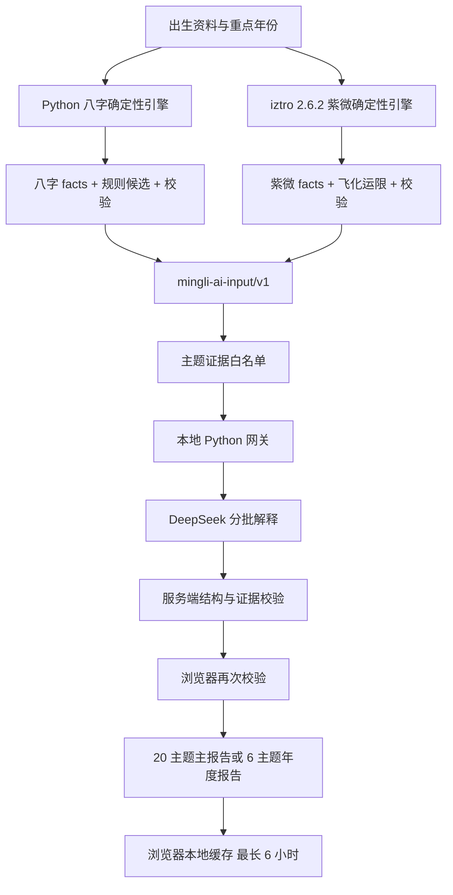

# 命理工具项目当前 Agent 交接

> 交接日期：2026-10-28  
> 项目目录：`C:\Users\hao\Documents\ChatGPT\New project\mingli-tool`  
> 本地测试地址：`http://127.0.0.1:8765/`  
> GitHub：`zhiweihao2-gif/codex`，分支 `codex/mingli-v0.1`  
> GitHub 当前提交：[`ca28cb773b26975fd50d38102d73f0d1ec7934de`](https://github.com/zhiweihao2-gif/codex/commit/ca28cb773b26975fd50d38102d73f0d1ec7934de)

## 接手前先看

1. 用户要做的是普通人能看懂的命理小程序，不是面向专业命理师的术语堆砌页面。
2. AI 只能解释程序已经计算并校验的八字、紫微事实，不能自行排盘、补星、补四化、补格局或编造现实经历。
3. 当前仍是本地测试阶段。用户明确说暂不做用户系统、全局调用和成本保护，也不需要公网托管或 tunnel。
4. DeepSeek 密钥位于项目根目录 `.env`，已被 Git 忽略。不要读取后输出密钥，不要提交 `.env`。
5. README 和 `docs/architecture.md` 有部分旧描述：其中“八字旺衰/格局/喜用/调候尚未实现”和“AI 仅 mock”已经过时。以现有代码、本交接文档和测试为准。
6. 静态 `dist/` 没有同步到当前源码状态，完整测试套件会因此失败。当前可靠运行方式是本地 Python 服务，不是 `dist/` 静态构建。
7. 本机系统 Python 安装不完整，缺少标准库 `encodings`。当前可用解释器是：

   ```powershell
   C:\Users\hao\AppData\Local\Temp\python-nuget-3.12.10\tools\python.exe
   ```

## 用户已经确认的产品原则

- 输入尽量简单：出生日期、时间、排盘性别；出生日期支持年填满自动跳月、月填满自动跳日。
- 公历/农历均可输入；时间可以精确到分钟、只知道时辰或完全未知。
- 八字与紫微使用同一份出生资料，但未知时辰时不猜紫微盘。
- 排盘层必须确定、可复核、可追溯；AI 只做白话翻译。
- 结果必须让没学过八字或紫微的人能理解，术语后面要说明生活语言含义。
- 八字和紫微证据分别引用，不能把两套体系混成一个来源。
- 健康、投资、法律等内容只作传统文化观察，不给决定性指令。
- 当前模型使用 DeepSeek，本地服务读取 `.env`；不把 API Key 放进浏览器代码。

## 当前已完成能力

### 输入与基础排盘

- 公历、农历输入。
- 年/月/日分栏输入与自动跳转。
- 分钟时间、十二时辰、未知时辰三种精度。
- 排盘性别、出生地经度、真太阳时、历史夏令时确认。
- 重点年份支持“今年”“明年”“自选年份”。
- 八字和紫微双盘共用同一次输入。

### 八字确定性层

- 四柱、十神、藏干、十二长生、五行清单、神煞。
- 起运、顺逆排、大运、流年和原局/运限关系。
- 干支合冲刑害破及合化条件审计。
- `bazi_facts.py` 生成带指纹、来源和校验状态的 AI 事实包。
- 已实现固定规则档案 `ziping-month-command-audited-v2`：
  - 身强身弱候选与逐项计分证据；
  - 月令格局和特殊格候选；
  - 扶抑、格局、调候三轴喜用候选；
  - 调候 120 单元速查覆盖；
  - 冲突、破格、成立项与置信度保留，不压成跨门派唯一答案。

关键文件：

- `src/mingli_tool/bazi.py`
- `src/mingli_tool/bazi_facts.py`
- `src/mingli_tool/bazi_rules.py`
- `scripts/pai_pan.py`

### 紫微斗数确定性层

- 固定引擎 `iztro 2.6.2`，本地 vendored，不依赖在线 CDN。
- 十二宫、主星/辅星、亮度、空宫借星、对宫与三合。
- 生年四化、十二宫宫干飞化、化忌链、自化向心/离心。
- 大限、流年及细运结构；事实包保留各层校验状态。
- 引入 `Renhuai123/ziwei-doushu` 的 13 个生活主题结构和格局候选思路，但没有让其文本直接替代本项目的证据校验。

关键文件：

- `web/vendor/iztro-v2.6.2.min.js`
- `web/ziwei-adapter.js`
- `web/ziwei-facts.js`
- `web/vendor/renhuai-patterns.js`
- `web/ziwei-interpretation.js`

### AI 契约与双盘报告

- 统一输入契约：`mingli-ai-input/v1`。
- 统一输出契约：`mingli-ai-interpretation/v1`。
- 每条解释必须引用真实存在的 JSON Pointer 证据路径。
- 服务端和浏览器端都会验证主题、结构、证据路径、安全措辞与适用边界。
- 主报告共 20 主题：八字 7 主题 + 紫微 13 主题。
- 支持 3 分钟重点摘要、主题目录、逐主题重生成。
- 分批请求 DeepSeek，避免长输出被截断。
- 浏览器本地缓存最长 6 小时，支持断点续跑、刷新恢复和手动清除；服务端不持久化出生资料或报告。

关键文件：

- `web/report-structure.js`
- `web/ai-contract.js`
- `web/ai-interpretation.js`
- `src/mingli_tool/web.py`
- `schemas/ai-interpretation-v1.schema.json`

### 年度专项报告

最后完成的功能是“重点年份 + 八字 × 紫微联合流年报告”：

- 选择今年、明年或自定义年份。
- 八字计算到所选年份，紫微以同一目标年份建立年度坐标。
- 生成 6 个主题：年度整体、工作学习、感情人际、金钱资源、身心节奏、家庭居住。
- 每个年度主题同时允许八字和紫微证据，但必须分别说明来源。
- 真实 DeepSeek 测试已完成：3 批请求成功，6 个主题全部生成，23 条证据引用通过校验。
- 刷新页面后重新输入同一测试盘，年度报告能从本机缓存恢复，服务端日志确认没有再次调用模型。

对应 GitHub 提交：`ca28cb773b26975fd50d38102d73f0d1ec7934de`。

## 当前数据流



## 如何运行

项目目录：

```powershell
Set-Location 'C:\Users\hao\Documents\ChatGPT\New project\mingli-tool'
```

确认 `.env` 只包含以下变量，不要把真实值写入文档或 Git：

```text
DEEPSEEK_API_KEY=<DeepSeek API Key>
DEEPSEEK_MODEL=<已配置的 DeepSeek 模型名>
```

启动本地服务：

```powershell
& 'C:\Users\hao\AppData\Local\Temp\python-nuget-3.12.10\tools\python.exe' web_tool.py --host 127.0.0.1 --port 8765
```

检查服务：

```powershell
Invoke-RestMethod http://127.0.0.1:8765/api/health
```

浏览器打开：

```text
http://127.0.0.1:8765/
```

服务可能已经由上一 Agent 保持运行；先访问健康接口，避免重复启动占用端口。

## HTTP 接口

| 方法 | 路径 | 用途 |
| --- | --- | --- |
| `GET` | `/api/health` | 返回服务状态和模型是否已配置 |
| `POST` | `/api/v1/bazi/calculate` | 计算八字；前端再用同一输入计算紫微 |
| `POST` | `/api/v1/interpret` | 接收事实契约和主题批次，调用 DeepSeek 并校验输出 |

`/api/v1/interpret` 不接收自由聊天提示词。前端只发送经过 `reportPlan` 白名单约束的主题和证据。

## 代码导航

| 任务 | 首先查看 |
| --- | --- |
| 网页表单、结果渲染、年份切换 | `web/index.html`、`web/app.js`、`web/styles.css` |
| 日期自动跳转 | `web/date-input.js` |
| 八字排盘与事实 | `src/mingli_tool/bazi.py`、`src/mingli_tool/bazi_facts.py` |
| 八字旺衰/格局/喜用/调候 | `src/mingli_tool/bazi_rules.py` |
| 紫微排盘与事实 | `web/ziwei-adapter.js`、`web/ziwei-facts.js` |
| 20 + 6 主题证据规划 | `web/report-structure.js` |
| AI 输入契约 | `web/ai-contract.js` |
| AI 分批、验证、缓存 | `web/ai-interpretation.js` |
| DeepSeek 服务端网关 | `src/mingli_tool/web.py` |
| AI 边界文档 | `docs/ai-readiness.md`、`docs/ai-interpretation-protocol.md` |

## 测试现状

### 已通过的测试

2026-10-28 实际执行结果：

- 上游八字回归：11 项通过。
- 聚焦后端测试 `tests.test_web_server` + `tests.test_bazi_adapter`：18 项通过。
- `tests/date_input.test.cjs`：通过。
- `tests/interpretation.test.cjs`：通过。
- `tests/ziwei_interpretation.test.cjs`：通过。
- `tests/ai_contract.test.cjs`：通过。
- `tests/ai_interpretation.test.cjs`：36 项通过。
- `node --check web/report-structure.js web/ai-interpretation.js web/app.js`：通过。
- 浏览器真实测试：年份切换、年度 6 主题、DeepSeek 三批生成、刷新缓存恢复均通过。

推荐的聚焦测试命令：

```powershell
$python = 'C:\Users\hao\AppData\Local\Temp\python-nuget-3.12.10\tools\python.exe'
& $python scripts/test_pai_pan.py
& $python -m unittest tests.test_web_server tests.test_bazi_adapter
node tests/date_input.test.cjs
node tests/interpretation.test.cjs
node tests/ziwei_interpretation.test.cjs
node tests/ai_contract.test.cjs
node tests/ai_interpretation.test.cjs
node --check web/report-structure.js
node --check web/ai-interpretation.js
node --check web/app.js
```

### 当前已知失败

不要把下面问题误判为新功能回归：

1. `python -m unittest discover -s tests -v` 当前为 29 项中 1 个失败、18 个错误。主要原因是 `dist/index.html`、`dist/python/...` 等静态构建产物不存在或未刷新；源码运行链路不依赖这些文件。
2. `tests/ziwei_adapter.test.cjs` 的一条金标准仍只期待天魁、天钺，实际结果还包含后来加入的截空、副截、副旬和大耗修正。需要更新 fixture 或把修正测试拆开，不能简单删除实际修正。
3. `dist/` 当前只保留 `dist/server/index.js`，静态站构建管线尚未按最新源码恢复。
4. README 和部分 `docs/` 内容落后于当前实现，需要统一更新。

## Git 状态

- 本地分支：`codex/mingli-v0.1`
- 本地最新提交：`ca8df83acab9678a69e485dd3d4e0eaa5c57c8c2`
- GitHub 分支最新提交：`ca28cb773b26975fd50d38102d73f0d1ec7934de`
- 两个提交内容对应同一轮年度功能，但 SHA 不同：本机直接 `git push` 会等待认证，上一 Agent 使用 GitHub connector 按文件创建远端提交。
- 本地 `origin/codex/mingli-v0.1` 跟踪引用仍是旧值，`git status` 会显示 ahead；不要据此认为 GitHub 没同步。
- 接手后如要统一历史，先读取 GitHub 分支实际 HEAD，再决定 fetch/rebase；不要使用 `git reset --hard`，也不要覆盖用户未提交内容。

## 下一阶段建议

用户已经同意下一步做“年度时间轴”。建议按以下顺序实施：

1. 先补确定性的月份事实层，不让 AI 根据年盘猜月份。
2. 八字逐月计算月干支，并核对原局、大运、流年、流月之间的合冲刑害破及条件。
3. 紫微只采用引擎能够确定计算并通过校验的流月宫位、四化、流曜和叠宫。
4. 生成上半年、下半年和 12 个月的结构化时间轴。
5. 每月固定展示：盘面变化、工作/关系/资源/身心观察、八字依据、紫微依据、两套体系一致点、冲突点和不能确定的内容。
6. AI 只把这些事实翻译成普通话，不自行选择“吉月”“凶月”，不补具体事件。
7. 增加立春换年、节气换月、农历闰月、跨年和两套月份坐标一致性测试。
8. 完成后再优化小程序式首页：默认只显示年度三条主线、值得提前准备的月份、适合放慢检查的月份，详细证据按需展开。

### 下一阶段完成标准

- 12 个月均有机器可读事实包和证据路径。
- 月份边界由确定性规则决定，AI 不参与日期计算。
- 每条月度解释至少引用一个八字或紫微事实；联合结论分别列出两套证据。
- 冲突不强行合并，资料不足直接说明。
- 页面在手机宽度下可用，默认信息量不压迫普通用户。
- 新测试通过，同时不破坏 20 主题主报告和 6 主题年度报告缓存。

## Evidence → finding → path

| Evidence | Finding | Path |
| --- | --- | --- |
| 八字规则输出含计分、成立项、反证、冲突和置信度 | 旺衰、格局、喜用、调候已经是确定性候选层，不应再让 AI 自算 | `src/mingli_tool/bazi_rules.py` |
| 紫微 facts 含宫位、飞化、运限和校验状态 | AI 可解释紫微结构，但必须引用冻结后的 facts | `web/ziwei-facts.js` |
| 报告主题逐项绑定证据白名单 | 主报告和年度报告都能限制模型只引用给定事实 | `web/report-structure.js` |
| 浏览器与服务端均校验证据路径 | 模型输出不是直接显示，需两层校验 | `web/ai-interpretation.js`、`src/mingli_tool/web.py` |
| 真实年度报告 6 主题、23 条引用通过 | 年度专项链路已具备可用基线 | GitHub 提交 `ca28cb7` 与本机浏览器缓存 |
| 完整 discover 缺少静态构建文件 | `dist/` 是当前主要工程欠账之一 | `tests/test_static_distribution.py`、`dist/` |

## 不要做的事情

- 不要把 `.env` 或 API Key 提交到 GitHub。
- 不要把 AI 输出当排盘结果写回 facts。
- 不要让 AI 自行判断月份边界、立春、闰月、四化或星曜落宫。
- 不要删除候选、冲突和置信度，只留下一个看似确定的结论。
- 不要急着做账号、支付、调用额度或正式公网部署；用户当前优先验证核心内容质量。
- 不要直接照搬第三方 skill 的解释文本；只借鉴结构、规则来源和可核对字段，并保留许可证与来源说明。

