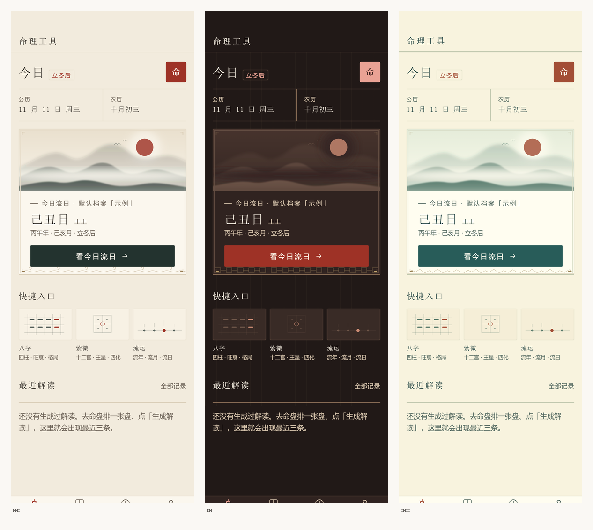

# 小程序主题体系（design/miniprogram）

三套主题，随时切，13 屏共用同一套变量。切换只换颜色，不动排版与内容。

## 三套

| 主题 | 名字 | 气质 | 底色 / 正文 | 主色 / 强调 |
| --- | --- | --- | --- | --- |
| `songke`（默认） | 宋刻本 | 宣纸、墨字、朱砂印 | `#F2EBDD` / `#1F1B16` | `#23332F` / `#9E3226` |
| `daoguan` | 道观 | 深底、暖白字、铜金线 | `#211917` / `#F8F1E4` | `#9E3226` / `#E9A294` |
| `qinglv` | 青绿绢本 | 绢底、墨青字、赭石点 | `#F8F3DE` / `#183B3B` | `#285C59` / `#A34E36` |

对比度（正文 / 底色，WCAG 比值）：

| 主题 | 正文/底 | 正文/卡面 | 次要字/底 | 次要字/卡面 |
| --- | --- | --- | --- | --- |
| songke | 14.43 | 16.01 | 5.18 | 5.75 |
| daoguan | 15.37 | 13.48 | 10.26 | 9.00 |
| qinglv | 10.92 | 11.90 | 5.54 | 6.04 |

门槛写进了测试：正文 ≥ 7:1、次要字 ≥ 4.5:1、按钮文字 ≥ 4.5:1。



## 怎么切

正式入口：`me.html` 的「外观」卡，三条各点一下即可，选择记在 `localStorage["mingli.theme.v1"]`，之后所有页面沿用。

临时预览（不改记忆）：任意页面加 `?theme=daoguan` / `?theme=qinglv` / `?theme=songke`。

改默认主题：把 `tokens.css` 第一行换成 `@import "./themes/<name>.css";`。

## 文件结构

```
design/miniprogram/
  tokens.css            结构变量（字体、字号、间距、圆角、层级高度），无颜色
  themes/songke.css     21 个颜色变量 + 自己的纹样遮罩
  themes/daoguan.css
  themes/qinglv.css
  themes/switch.js      读 ?theme= / localStorage，拼 <link> 进来
  themes/README.md      变量表与约定
  ornaments/cloud.svg   宋刻本横纹（挂在 .hero::after）
  ornaments/thunder.svg 道观雷纹
  ornaments/mountain.svg 青绿山形
```

`tokens.css` 的第一行就是主题入口——这一行决定默认长什么样，其余全是从它继承的颜色。

## 颜色变量（21 个，三套必须齐全）

`--bg --surface --surface-2 --text --muted --line --line-soft --primary --primary-ink --accent --accent-ink --gold --on --link --wash --wash-deep --nav-bg --shadow-color --art-ink --art-sun`

`--primary-ink` / `--accent-ink` 是「压在 primary/accent 底色上的字色」，专门用于深色主题里主色变浅的情况。
`--art-ink` / `--art-sun` 是插图专用（山、日、线），和正文色分开：深底主题里正文是浅色，插图要用中间调才不会糊成一片。

## 纹样的坑

CSS `mask-image: url(x.svg#id)` **只能引用整张图或 `<mask>`**，引用 `<symbol>` / `<view>` 的 `#id` 不生效。
所以一张纹样一个文件，`stroke="#fff"` + `fill="none"`（mask 只看 alpha，颜色由 CSS 的 `background-color` 给）。

## 已知限制

- 只做了三套，没做自定义取色。
- 主题只控制颜色与纹样；字号、间距、圆角是全站统一的，不随主题变。
- 原生 `<option>` 由系统绘制，只能在 `frame.css` 里给 `background` / `color`，部分 Android WebView 仍会忽略。
- `ornaments/` 里另有四张旧花纹（`huiwen`/`jiaohua`/`yin`/`yunwen`）没被引用，保留备用；测试只允许这四张作为「未引用但已登记」的例外，新增未引用的图会报错。
